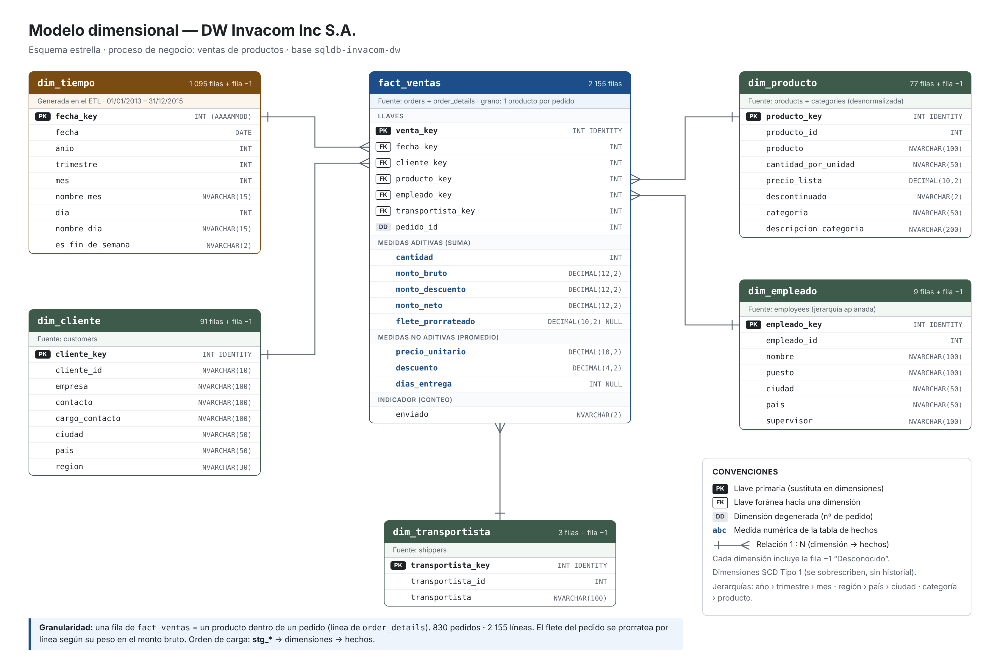
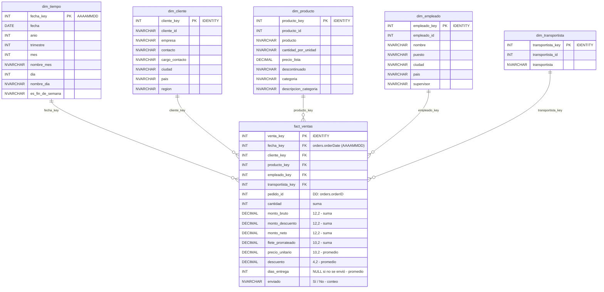

# Modelo dimensional – DW Invacom Inc S.A.

- **Tipo de esquema:** estrella.
- **Proceso de negocio:** ventas de productos.
- **Base de datos:** `sqldb-invacom-dw`.
- **Granularidad:** una fila de `fact_ventas` = un producto dentro de un pedido (línea de `order_details`). 830 pedidos, 2 155 filas.

## Tabla de hechos: `fact_ventas`

Fuente: `orders` + `order_details`.

| Columna | Tipo | Rol | Agregación |
|---|---|---|---|
| venta_key | INT IDENTITY | PK | — |
| fecha_key | INT | FK → dim_tiempo | — |
| cliente_key | INT | FK → dim_cliente | — |
| producto_key | INT | FK → dim_producto | — |
| empleado_key | INT | FK → dim_empleado | — |
| transportista_key | INT | FK → dim_transportista | — |
| pedido_id | INT | Dimensión degenerada | Conteo de distintos |
| cantidad | INT | Medida | Suma |
| monto_bruto | DECIMAL(12,2) | Medida | Suma |
| monto_descuento | DECIMAL(12,2) | Medida | Suma |
| monto_neto | DECIMAL(12,2) | Medida | Suma |
| flete_prorrateado | DECIMAL(10,2) NULL | Medida | Suma |
| precio_unitario | DECIMAL(10,2) | Medida | Promedio |
| descuento | DECIMAL(4,2) | Medida | Promedio |
| dias_entrega | INT NULL | Medida | Promedio |
| enviado | NVARCHAR(2) | Indicador ("Sí" / "No") | Conteo |

**Cálculos:**
- `monto_bruto` = cantidad × precio_unitario
- `monto_descuento` = monto_bruto × descuento
- `monto_neto` = monto_bruto − monto_descuento
- `flete_prorrateado` = `orders.freight` repartido entre las líneas del pedido según su peso en el monto bruto
- `dias_entrega` = `shippedDate` − `orderDate`; NULL si el pedido no se ha enviado

## Dimensiones

| Dimensión | Fuente | Filas | Atributos |
|---|---|---|---|
| `dim_tiempo` | Generada en el ETL | 1 095 + fila −1 | fecha_key (AAAAMMDD), fecha, anio, trimestre, mes, nombre_mes, dia, nombre_dia, es_fin_de_semana |
| `dim_cliente` | customers | 91 + fila −1 | cliente_key, cliente_id, empresa, contacto, cargo_contacto, ciudad, pais, region |
| `dim_producto` | products + categories | 77 + fila −1 | producto_key, producto_id, producto, cantidad_por_unidad, precio_lista, descontinuado, categoria, descripcion_categoria |
| `dim_empleado` | employees | 9 + fila −1 | empleado_key, empleado_id, nombre, puesto, ciudad, pais, supervisor |
| `dim_transportista` | shippers | 3 + fila −1 | transportista_key, transportista_id, transportista |

**Jerarquías:**
- `dim_tiempo`: año › trimestre › mes › día
- `dim_cliente`: región › país › ciudad
- `dim_producto`: categoría › producto

## Reglas del modelo

- **Relaciones:** cada dimensión se relaciona 1 : N con `fact_ventas`.
- **Llaves sustitutas:** cada dimensión usa una llave `*_key` generada en el DW y conserva la llave original de la fuente (`*_id`). La excepción es `dim_tiempo`, cuya llave es la fecha en formato AAAAMMDD.
- **Fila "Desconocido":** cada dimensión tiene una fila con llave −1 para los hechos cuya referencia no se encuentra.
- **Tipo de dimensión:** todas son SCD Tipo 1, es decir, los cambios se sobrescriben y no se guarda historial.
- **Desnormalización:** `categories` se integra en `dim_producto`, y la jerarquía de `employees` se resuelve en el atributo `supervisor` de `dim_empleado`.
- **Precio:** `precio_unitario` es el precio real de cada venta (`order_details.unitPrice`). `precio_lista` es el precio actual del catálogo y solo es un atributo de `dim_producto`.
- **Orden de carga:** primero las tablas staging (`stg_*`), después las dimensiones y al final los hechos.

## Versión Mermaid

## Convenciones

- **PK:** llave primaria.
- **FK:** llave foránea hacia una dimensión.
- **DD:** dimensión degenerada.
